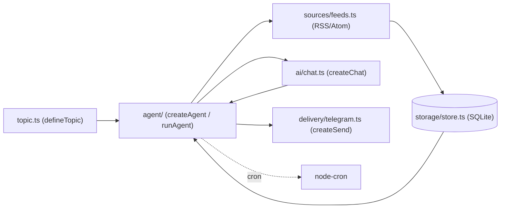

# 📬 @juninmd/digest-kit

<div align="center">

**Núcleo reutilizável para criação de agentes de digest autônomos.**  
*RSS → SQLite → IA → Telegram*

[](https://www.npmjs.com/package/@juninmd/digest-kit)
[](https://github.com/juninmd/digest-kit/actions)
[](https://bun.sh)
[](https://nodejs.org)
[](LICENSE)

</div>

---

O `@juninmd/digest-kit` é uma biblioteca para quem mantém agentes de resumo diário (digest) e não quer reescrever a mesma infraestrutura a cada tópico. Ele resolve o ciclo completo: coleta feeds RSS/Atom, deduplica em SQLite, resume com um LLM e publica no Telegram. O agente consumidor escreve apenas o arquivo de tópico (nome, prompt de sistema e feeds).

## Índice

- [Funcionalidades](#-funcionalidades)
- [Arquitetura](#-arquitetura)
- [Instalação](#-instalação)
- [Uso rápido](#-uso-rápido)
- [Configuração](#-configuração-variáveis-de-ambiente)
- [Garantias e resiliência](#-garantias-e-resiliência)
- [Subpath core](#-juninmddigest-kitcore-nodejs--bun)
- [Busca vetorial](#-busca-vetorial-sqlite-vec)
- [Desempenho](#-desempenho)
- [Desenvolvimento e gates de CI](#-desenvolvimento)

## ✨ Funcionalidades

- `defineTopic` / `runAgent` / `createAgent`: definição do tópico e CLI padrão do agente (`--ingest`, `--digest`, `--loop`, `--status`, `--dry-run`, `--help`).
- Ingestão de feeds RSS/Atom com falha isolada por feed, limite de itens (`MAX_ITEMS_PER_FEED`) e de leituras simultâneas (`FEED_CONCURRENCY`).
- Persistência e deduplicação em SQLite (`bun:sqlite`), com id derivado do hash do link; cada feed é gravado em uma transação.
- `--status` / `agent.status()` / `store.stats()`: pendentes, enviados e última coleta, sem tocar em feed, IA ou Telegram.
- Chat com LLM por provedor: `ollama`, `openai`, `anthropic`, `google` ou `compatible` (gateway OpenAI-compatível).
- Entrega no Telegram com quebra de mensagem longa; Markdown recusado (400) é reenviado como texto simples; se nenhum chat recebe, os itens continuam pendentes. Sem token, imprime no console.
- Hook `onDigest` (em `createAgent`/`runAgent`) para arquivar cada digest enviado em outro destino.
- Busca vetorial e deduplicação semântica local via `sqlite-vec` (`createVectorStore` / `loadSqliteVec` com tabelas virtuais `vec0`), com métrica `l2`, `cosine` ou `l1` e gravação em lote (`upsertMany`).
- Agendamento por cron (`node-cron`) para ingestão e digest.
- Primitivas puras em `@juninmd/digest-kit/core`, sem `bun:*`: `extractArticleFromHtml`, `extractJsonObject`, `isSafeExternalUrl`, `withRetry`, `runModelChain`, `mapSettled`, filtros de prosa e `redact`.

## 🏗️ Arquitetura



O `src/` segue as etapas do pipeline:

```text
src/
├── index.ts        entrada Bun: tudo
├── core.ts         entrada ./core: só o que roda em Node
├── types.ts        contratos (Topic, Config, Store, Agent...)
├── agent/          orquestração: agent.ts, cli.ts, args.ts, config.ts
├── sources/        entrada de conteúdo: feeds.ts, extract.ts
├── storage/        bun:sqlite: store.ts, vector.ts
├── ai/             chat.ts, chain.ts, prose.ts
├── delivery/       telegram.ts
└── util/           text, json, net, retry, redact, concurrency
```

`storage/` é o único diretório que importa `bun:sqlite`, e nada alcançável a partir de `src/core.ts` pode importar `bun:*` nem `storage/`. `tests/architecture.test.ts` percorre o grafo de imports e falha se isso for quebrado; o mesmo teste congela a lista de exports da 0.4.0, que só pode crescer.

---

## 🚀 Instalação

**Requisitos:** Bun `>=1.1.0` (pacote raiz, usa `bun:sqlite`) ou Node `>=20` (apenas o subpath `./core`).

Disponível no registro público do **npm**:

```bash
# Para agentes em Bun (recomendado):
bun add @juninmd/digest-kit
```

```bash
# Para projetos Node.js utilizando as primitivas agnósticas (./core):
npm install @juninmd/digest-kit
```

---

## ⚡ Uso Rápido

Um agente inteiro cabe em apenas dois arquivos:

### 1. Defina o tópico (`src/topic.ts`)

```ts
import { defineTopic } from "@juninmd/digest-kit";

export const topic = defineTopic({
  name: "tech-radar",
  title: "Tech Radar",
  emoji: "⚡",
  subject: "tecnologia e desenvolvimento de software",
  systemPrompt: `Você é um curador técnico. Resuma as novidades de tecnologia para desenvolvedores:
- Sempre em português do Brasil.
- Formato: lista limpa em Markdown com bullet points.
- Para cada item: título em negrito, 1 frase de síntese e link.
- Descarte conteúdo promocional ou duplicado.`,
  feeds: [
    { name: "Hacker News", url: "https://hnrss.org/frontpage" },
    { name: "GitHub Blog", url: "https://github.blog/feed/" },
  ],
});
```

### 2. Execute o agente (`src/index.ts`)

```ts
import { runAgent } from "@juninmd/digest-kit";
import { topic } from "./topic.ts";

await runAgent(topic);
```

Para arquivar cada digest enviado (ex.: num second brain), passe `onDigest`. Ele roda só depois de um envio bem-sucedido e uma falha nele vira log, sem desfazer o envio:

```ts
await runAgent(topic, {
  onDigest: async ({ topic, message, items }) => {
    await fetch(process.env.ARCHIVE_URL!, { method: "POST", body: JSON.stringify({ topic: topic.name, message, items }) });
  },
});
```

### 🛠️ CLI Integrada

Seu agente já conta com comandos prontos:

| Comando | Descrição |
|---|---|
| `bun run src/index.ts` | Ciclo único completo: ingestão de feeds + geração do digest |
| `bun run src/index.ts --ingest` | Apenas coleta novos itens dos feeds e grava no banco |
| `bun run src/index.ts --digest` | Apenas resume itens pendentes e transmite a mensagem |
| `bun run src/index.ts --loop` | Fica ativo em segundo plano executando os agendamentos cron; um disparo é ignorado se a execução anterior ainda não terminou |
| `bun run src/index.ts --status` | Mostra a fila (pendentes, enviados, total, última coleta). Não busca feeds, não chama a IA e não envia nada |
| `bun run src/index.ts --digest --dry-run` | Monta o digest e imprime, sem enviar e sem marcar itens (vale também sem modo) |
| `bun run src/index.ts --help` | Mostra o uso; argumento desconhecido sai com código 2 sem rodar nada |

> Veja um agente completo e funcional na pasta [`examples/meu-agente`](examples/meu-agente).

### 📟 Exemplos de execução

Saídas reais do exemplo, sem credenciais (`DB_PATH=:memory:`, sem `TELEGRAM_BOT_TOKEN`), registradas em [`docs/terminal.txt`](docs/terminal.txt):

```bash
DB_PATH=:memory: bun run example -- --ingest
```

```text
  + 10 de GitHub Blog
[ingest] 10 itens novos
```

Um feed indisponível vira aviso e não derruba o ciclo (nesse ambiente o Hacker News recusou a conexão):

```text
  ! feed "Hacker News" falhou: Error: ECONNREFUSED
```

```bash
DB_PATH=:memory: bun run example -- --digest
```

```text
[digest] nada novo para resumir
```

Com o banco em arquivo, depois de um `--ingest` em outro processo:

```bash
DB_PATH=./data/store.db bun run example -- --status
```

```text
[status] meu-agente: 30 pendentes, 0 enviados, 30 no total
[status] última coleta: 2026-11-10T03:24:56.108Z
```

- Sem `TELEGRAM_BOT_TOKEN`/`TELEGRAM_CHAT_IDS`, o digest é impresso no console com o prefixo `[telegram] não configurado — imprimindo no console` (comportamento de `src/delivery/telegram.ts`).
- O ciclo completo (`bun run example`, sem flag) chama o provedor de IA e **não foi executado** aqui: saída não verificada.

---

## ⚙️ Configuração (Variáveis de Ambiente)

O Bun carrega arquivos `.env` automaticamente. Todas as variáveis possuem padrões seguros. Contagens (`MAX_ITEMS_PER_FEED`, `DIGEST_MAX_ITEMS`, `FEED_CONCURRENCY`) precisam ser inteiros >= 1; valor inválido volta ao padrão. Um `AI_PROVIDER` desconhecido é recusado com erro em vez de cair no Ollama.

| Variável | Padrão | Descrição |
|---|---|---|
| `AI_PROVIDER` | `ollama` | Provedor: `ollama`, `openai`, `anthropic`, `google` ou `compatible` |
| `AI_BASE_URL` / `AI_API_KEY` / `AI_MODEL` | — | Usados por `AI_PROVIDER=compatible` (LiteLLM, vLLM, Groq, OpenRouter) |
| `AI_TEMPERATURE` | `0.4` | Temperatura do modelo de IA |
| `AI_TIMEOUT_MS` | `300000` | Tempo máximo de espera pela resposta do provedor; `0` desliga. Estourou, o digest sai com a lista bruta |
| `TELEGRAM_BOT_TOKEN` | — | Token do bot. Se omitido, o digest é impresso no console |
| `TELEGRAM_CHAT_IDS` | — | IDs de chats/canais separados por vírgula (`TELEGRAM_CHAT_ID` também é aceito) |
| `CRON_INGESTION` | `*/30 * * * *` | Expressão cron para ingestão dos feeds |
| `CRON_DIGEST` | `0 11 * * *` | Expressão cron para envio do digest |
| `DB_PATH` | `./data/store.db` | Caminho do SQLite (`:memory:` aceito) |
| `MAX_ITEMS_PER_FEED` | `20` | Limite de itens coletados por feed por execução |
| `DIGEST_MAX_ITEMS` | `12` | Quantidade máxima de itens resumidos por ciclo |
| `FEED_TIMEOUT_MS` | `12000` | Timeout de rede para requisições de feeds RSS |
| `FEED_CONCURRENCY` | `8` | Quantos feeds são lidos ao mesmo tempo |
| `TZ_DISPLAY` / `LOCALE` | `America/Sao_Paulo` / `pt-BR` | Fuso horário e formatação de datas no cabeçalho |

---

## 🛡️ Garantias e Resiliência

- **Deduplicação garantida:** Chave primária baseada em hash SHA-1 do link evita repetições.
- **Isolamento de falhas:** Feeds fora do ar geram avisos em log sem interromper os demais (`mapSettled`, com no máximo `FEED_CONCURRENCY` leituras simultâneas).
- **Gravação em lote:** Os itens de cada feed entram em uma transação: um commit por feed, não um por item.
- **Sem espera infinita:** Chamadas ao provedor de IA (`AI_TIMEOUT_MS`) e ao Telegram (30 s) têm limite de tempo.
- **Sem digest em dobro no `--loop`:** Um disparo do cron é ignorado enquanto a execução anterior daquele ciclo ainda roda.
- **Reserva sem IA:** Se a IA falhar ou retornar em branco, o agente entrega a lista bruta formatada para não perder o dia.
- **Entrega atômica:** Falhas de envio ao Telegram não marcam os itens como digeridos, reenviando-os no próximo ciclo.
- **Quebra de mensagens:** Textos que ultrapassam o limite do Telegram são fatiados em quebras de linha naturais.
- **Proteção de credenciais:** Erros retornados por APIs externas passam por `redact()` para evitar vazamento acidental de tokens e chaves em logs.

---

## 🧩 `@juninmd/digest-kit/core` (Node.js & Bun)

Para microsserviços ou aplicações Node.js que precisam de primitivas puras sem dependências de `bun:*`:

```ts
import {
  extractArticleFromHtml,
  extractJsonObject,
  isSafeExternalUrl,
  isPollutedProse,
  mapSettled,
  runModelChain,
  withRetry,
  redact,
} from "@juninmd/digest-kit/core";

// Extrai corpo limpo (Fit Markdown) e metadados de página HTML sem ruído/boilerplate
const article = extractArticleFromHtml(rawHtml);
if (article) {
  console.log(article.title, article.contentMarkdown);
}

// Extrai JSON válido gerado por LLMs envolvido em prosa/cercas markdown
const data = extractJsonObject(llmResponse);

// Validação contra SSRF (bloqueia 127.0.0.1, 169.254.169.254, ranges privados e *.internal)
if (isSafeExternalUrl(url)) {
  /* ... */
}

// Execução resiliente com retry exponencial
const result = await withRetry(() => fetchData(), { attempts: 3, baseMs: 1000 });

// Cadeia de fallback entre modelos com retry para rate limit
const text = await runModelChain(
  ["gpt-4o-mini", "gemini-2.5-flash"],
  async (model) => callModel(model, prompt),
);

// Promise.allSettled com limite de chamadas simultâneas (aqui, 4 por vez)
const pages = await mapSettled(urls, (url) => fetch(url).then((r) => r.text()), 4);
```

---

## 🧭 Busca vetorial (`sqlite-vec`)

```ts
import { Database } from "bun:sqlite";
import { createVectorStore } from "@juninmd/digest-kit";

const db = new Database("./data/vectors.db");
const vectors = createVectorStore(db, {
  dimensions: 384,
  distanceMetric: "cosine", // "l2" (padrão), "cosine" ou "l1"
});

// Lote inteiro em uma transação: ou entra tudo, ou nada
vectors.upsertMany([
  { id: "item-1", embedding: embeddingA },
  { id: "item-2", embedding: embeddingB },
]);

vectors.search(queryEmbedding, 5); // [{ id, distance }, ...] do mais próximo ao mais distante
vectors.hasSimilar(queryEmbedding, 0.1); // já existe algo a até 0.1 de distância?
```

A métrica é fixada na criação da tabela. Abrir uma tabela existente pedindo outra métrica lança erro, em vez de devolver distâncias numa escala diferente da esperada.

---

## 🚄 Desempenho

`bun run bench` roda um benchmark reprodutível (entradas determinísticas, sem rede) dos caminhos quentes. O antes/depois da 0.5.0, com método, máquina e ressalvas, está em [`docs/BENCHMARK.md`](docs/BENCHMARK.md). Alguns números de lá (mediana de três execuções por lado, VM compartilhada):

| Caso | 0.4.0 | 0.5.0 |
|---|---:|---:|
| Ingestão de 20 feeds x 50 itens novos, banco em arquivo | 214,72 ms | 22,52 ms |
| Mesma ingestão, itens já gravados | 13,62 ms | 4,88 ms |
| `clean` de um resumo de 64 KB | 248,73 µs | 0,57 µs |
| Gravar 200 embeddings de 384 dimensões, banco em arquivo | 70,06 ms | 7,16 ms |
| Chamadas `fsync` na ingestão acima | 1009 | 20 |

---

## 🧪 Desenvolvimento

```bash
bun install --frozen-lockfile
bun test          # Suite completa de 159 testes, sem rede
bun run build     # Compila dist/core.js e dist/core.d.ts para Node.js
bun run typecheck # Checagem estrita de tipos TypeScript
bun run bench     # Benchmark dos caminhos quentes (ver docs/BENCHMARK.md)
```

O repositório não define script de lint próprio. Para rodar o exemplo localmente: `bun run example`.

### Gates de CI

| Workflow | Gatilho | O que checa |
|---|---|---|
| `.github/workflows/validate.yml` | PR e push em `main` | Reusable `juninmd/base-actions` (`reusable-validate.yml`): validação do PR, auditoria de dependências (severidade `high`, bloqueante) e varredura de segredos no intervalo do PR |
| `.github/workflows/security.yml` | push em `main`, semanal (domingo 00:00 UTC), manual | Reusable `reusable-security-scan.yml` (Gitleaks) |
| `.github/workflows/publish.yml` | tag `v*` | Exige tag igual à `version` do `package.json`; roda `typecheck`, `test`, `build` e `npm publish --access public` (segredo `NPM_TOKEN`) |

### Screenshot

Não se aplica: biblioteca/CLI sem interface gráfica. A saída de terminal está em [`docs/terminal.txt`](docs/terminal.txt).

---

## 📄 Licença

Distribuído sob a licença [MIT](LICENSE).
