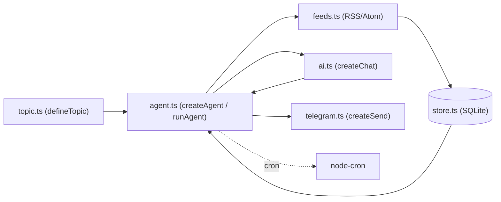

# 📬 @juninmd/digest-kit

<div align="center">

**Núcleo reutilizável para criação de agentes de digest autônomos.**  
*RSS → SQLite → IA → Telegram*

[](https://www.npmjs.com/package/@juninmd/digest-kit)
[](https://github.com/juninmd/digest-kit/actions)
[](https://bun.sh)
[](https://nodejs.org)
[](LICENSE)

</div>

---

O `@juninmd/digest-kit` é uma biblioteca para quem mantém agentes de resumo diário (digest) e não quer reescrever a mesma infraestrutura a cada tópico. Ele resolve o ciclo completo: coleta feeds RSS/Atom, deduplica em SQLite, resume com um LLM e publica no Telegram. O agente consumidor escreve apenas o arquivo de tópico (nome, prompt de sistema e feeds).

## Índice

- [Funcionalidades](#-funcionalidades)
- [Arquitetura](#-arquitetura)
- [Instalação](#-instalação)
- [Uso rápido](#-uso-rápido)
- [Configuração](#-configuração-variáveis-de-ambiente)
- [Garantias e resiliência](#-garantias-e-resiliência)
- [Subpath core](#-juninmddigest-kitcore-nodejs--bun)
- [Desenvolvimento e gates de CI](#-desenvolvimento)

## ✨ Funcionalidades

- `defineTopic` / `runAgent` / `createAgent`: definição do tópico e CLI padrão do agente (`--ingest`, `--digest`, `--loop`).
- Ingestão de feeds RSS/Atom com falha isolada por feed e limite de itens (`MAX_ITEMS_PER_FEED`).
- Persistência e deduplicação em SQLite (`bun:sqlite`), com id derivado do hash do link.
- Chat com LLM por provedor: `ollama`, `openai`, `anthropic`, `google` ou `compatible` (gateway OpenAI-compatível).
- Entrega no Telegram com quebra de mensagem longa; sem token, imprime no console.
- Agendamento por cron (`node-cron`) para ingestão e digest.
- Primitivas puras em `@juninmd/digest-kit/core`, sem `bun:*`: `extractJsonObject`, `isSafeExternalUrl`, `withRetry`, `runModelChain`, filtros de prosa e `redact`.

## 🏗️ Arquitetura



Os módulos usados também no Node (`ai.ts`, `chain.ts`, `json.ts`, `net.ts`, `prose.ts`, `retry.ts`, `text.ts`) são reexportados por `src/core.ts`; `store.ts` depende de `bun:sqlite` e fica fora dele.

---

## 🚀 Instalação

**Requisitos:** Bun `>=1.1.0` (pacote raiz, usa `bun:sqlite`) ou Node `>=20` (apenas o subpath `./core`).

Disponível no registro público do **npm**:

```bash
# Para agentes em Bun (recomendado):
bun add @juninmd/digest-kit
```

```bash
# Para projetos Node.js utilizando as primitivas agnósticas (./core):
npm install @juninmd/digest-kit
```

---

## ⚡ Uso Rápido

Um agente inteiro cabe em apenas dois arquivos:

### 1. Defina o tópico (`src/topic.ts`)

```ts
import { defineTopic } from "@juninmd/digest-kit";

export const topic = defineTopic({
  name: "tech-radar",
  title: "Tech Radar",
  emoji: "⚡",
  subject: "tecnologia e desenvolvimento de software",
  systemPrompt: `Você é um curador técnico. Resuma as novidades de tecnologia para desenvolvedores:
- Sempre em português do Brasil.
- Formato: lista limpa em Markdown com bullet points.
- Para cada item: título em negrito, 1 frase de síntese e link.
- Descarte conteúdo promocional ou duplicado.`,
  feeds: [
    { name: "Hacker News", url: "https://hnrss.org/frontpage" },
    { name: "GitHub Blog", url: "https://github.blog/feed/" },
  ],
});
```

### 2. Execute o agente (`src/index.ts`)

```ts
import { runAgent } from "@juninmd/digest-kit";
import { topic } from "./topic.ts";

await runAgent(topic);
```

### 🛠️ CLI Integrada

Seu agente já conta com comandos prontos:

| Comando | Descrição |
|---|---|
| `bun run src/index.ts` | Ciclo único completo: ingestão de feeds + geração do digest |
| `bun run src/index.ts --ingest` | Apenas coleta novos itens dos feeds e grava no banco |
| `bun run src/index.ts --digest` | Apenas resume itens pendentes e transmite a mensagem |
| `bun run src/index.ts --loop` | Fica ativo em segundo plano executando os agendamentos cron |

> Veja um agente completo e funcional na pasta [`examples/meu-agente`](examples/meu-agente).

### 📟 Exemplos de execução

Saídas reais do exemplo, sem credenciais (`DB_PATH=:memory:`, sem `TELEGRAM_BOT_TOKEN`), registradas em [`docs/terminal.txt`](docs/terminal.txt):

```bash
DB_PATH=:memory: bun run example -- --ingest
```

```text
  + 10 de GitHub Blog
[ingest] 10 itens novos
```

Um feed indisponível vira aviso e não derruba o ciclo (nesse ambiente o Hacker News recusou a conexão):

```text
  ! feed "Hacker News" falhou: Error: ECONNREFUSED
```

```bash
DB_PATH=:memory: bun run example -- --digest
```

```text
[digest] nada novo para resumir
```

- Sem `TELEGRAM_BOT_TOKEN`/`TELEGRAM_CHAT_IDS`, o digest é impresso no console com o prefixo `[telegram] não configurado — imprimindo no console` (comportamento de `src/telegram.ts`).
- O ciclo completo (`bun run example`, sem flag) chama o provedor de IA e **não foi executado** aqui: saída não verificada.
- `runAgent` não tem `--help`; argumentos desconhecidos executam um ciclo completo.

---

## ⚙️ Configuração (Variáveis de Ambiente)

O Bun carrega arquivos `.env` automaticamente. Todas as variáveis possuem padrões seguros:

| Variável | Padrão | Descrição |
|---|---|---|
| `AI_PROVIDER` | `ollama` | Provedor: `ollama`, `openai`, `anthropic`, `google` ou `compatible` |
| `AI_BASE_URL` / `AI_API_KEY` / `AI_MODEL` | — | Usados por `AI_PROVIDER=compatible` (LiteLLM, vLLM, Groq, OpenRouter) |
| `AI_TEMPERATURE` | `0.4` | Temperatura do modelo de IA |
| `TELEGRAM_BOT_TOKEN` | — | Token do bot. Se omitido, o digest é impresso no console |
| `TELEGRAM_CHAT_IDS` | — | IDs de chats/canais separados por vírgula (`TELEGRAM_CHAT_ID` também é aceito) |
| `CRON_INGESTION` | `*/30 * * * *` | Expressão cron para ingestão dos feeds |
| `CRON_DIGEST` | `0 11 * * *` | Expressão cron para envio do digest |
| `DB_PATH` | `./data/store.db` | Caminho do SQLite (`:memory:` aceito) |
| `MAX_ITEMS_PER_FEED` | `20` | Limite de itens coletados por feed por execução |
| `DIGEST_MAX_ITEMS` | `12` | Quantidade máxima de itens resumidos por ciclo |
| `FEED_TIMEOUT_MS` | `12000` | Timeout de rede para requisições de feeds RSS |
| `TZ_DISPLAY` / `LOCALE` | `America/Sao_Paulo` / `pt-BR` | Fuso horário e formatação de datas no cabeçalho |

---

## 🛡️ Garantias e Resiliência

- **Deduplicação garantida:** Chave primária baseada em hash SHA-256 do link evita repetições.
- **Isolamento de falhas:** Feeds fora do ar geram avisos em log sem interromper os demais (`Promise.allSettled`).
- **Reserva sem IA:** Se a IA falhar ou retornar em branco, o agente entrega a lista bruta formatada para não perder o dia.
- **Entrega atômica:** Falhas de envio ao Telegram não marcam os itens como digeridos, reenviando-os no próximo ciclo.
- **Quebra de mensagens:** Textos que ultrapassam o limite do Telegram são fatiados em quebras de linha naturais.
- **Proteção de credenciais:** Erros retornados por APIs externas passam por `redact()` para evitar vazamento acidental de tokens e chaves em logs.

---

## 🧩 `@juninmd/digest-kit/core` (Node.js & Bun)

Para microsserviços ou aplicações Node.js que precisam de primitivas puras sem dependências de `bun:*`:

```ts
import {
  extractJsonObject,
  isSafeExternalUrl,
  isPollutedProse,
  runModelChain,
  withRetry,
  redact,
} from "@juninmd/digest-kit/core";

// Extrai JSON válido gerado por LLMs envolvido em prosa/cercas markdown
const data = extractJsonObject(llmResponse);

// Validação contra SSRF (bloqueia 127.0.0.1, 169.254.169.254, ranges privados e *.internal)
if (isSafeExternalUrl(url)) {
  /* ... */
}

// Execução resiliente com retry exponencial
const result = await withRetry(() => fetchData(), { attempts: 3, baseMs: 1000 });

// Cadeia de fallback entre modelos com retry para rate limit
const text = await runModelChain(
  ["gpt-4o-mini", "gemini-2.5-flash"],
  async (model) => callModel(model, prompt),
);
```

---

## 🧪 Desenvolvimento

```bash
bun install --frozen-lockfile
bun test          # Suite completa de 68 testes unitários
bun run build     # Compila dist/core.js e dist/core.d.ts para Node.js
bun run typecheck # Checagem estrita de tipos TypeScript
```

O repositório não define script de lint próprio. Para rodar o exemplo localmente: `bun run example`.

### Gates de CI

| Workflow | Gatilho | O que checa |
|---|---|---|
| `.github/workflows/validate.yml` | PR e push em `main` | Reusable `juninmd/base-actions` (`reusable-validate.yml`): validação do PR, auditoria de dependências (severidade `high`, bloqueante) e varredura de segredos no intervalo do PR |
| `.github/workflows/security.yml` | push em `main`, semanal (domingo 00:00 UTC), manual | Reusable `reusable-security-scan.yml` (Gitleaks) |
| `.github/workflows/publish.yml` | tag `v*` | Exige tag igual à `version` do `package.json`; roda `typecheck`, `test`, `build` e `npm publish --access public` (segredo `NPM_TOKEN`) |

### Screenshot

Não se aplica: biblioteca/CLI sem interface gráfica. A saída de terminal está em [`docs/terminal.txt`](docs/terminal.txt).

---

## 📄 Licença

Distribuído sob a licença [MIT](LICENSE).
